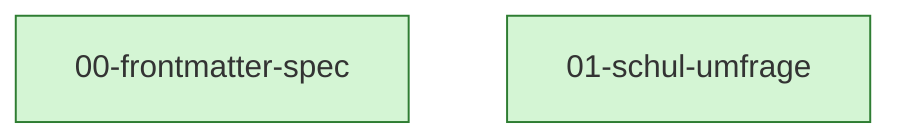

# MDD Connections

## Path Tree

```
Meta
└── Schema  00-frontmatter-spec  complete
Umfrage  01-schul-umfrage  complete
```

## Dependency Graph



## Source File Overlap

(none — no source file is referenced by two docs)

## Warnings

(none)
