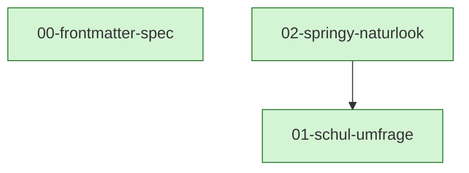

# MDD Connections

## Path Tree

```
Meta
└── Schema  00-frontmatter-spec  complete
Umfrage  01-schul-umfrage  complete
└── Aussehen  02-springy-naturlook  complete
```

## Dependency Graph



## Source File Overlap

| File | Docs |
|---|---|
| `server/domain/voice-texts.ts` | 01-schul-umfrage, 02-springy-naturlook |
| `server/handlers/voice-queue.ts` | 01-schul-umfrage, 02-springy-naturlook |
| `shared/phrases.ts` | 01-schul-umfrage, 02-springy-naturlook |
| `web/admin/App.tsx` | 01-schul-umfrage, 02-springy-naturlook |
| `web/admin/admin.css` | 01-schul-umfrage, 02-springy-naturlook |
| `web/admin/index.html` | 01-schul-umfrage, 02-springy-naturlook |
| `web/index.html` | 01-schul-umfrage, 02-springy-naturlook |
| `web/kiosk/Kiosk.tsx` | 01-schul-umfrage, 02-springy-naturlook |
| `web/kiosk/Prompt.tsx` | 01-schul-umfrage, 02-springy-naturlook |
| `web/kiosk/kiosk.css` | 01-schul-umfrage, 02-springy-naturlook |
| `web/kiosk/main.tsx` | 01-schul-umfrage, 02-springy-naturlook |
| `web/kiosk/screens.tsx` | 01-schul-umfrage, 02-springy-naturlook |
| `web/lib/speech.ts` | 01-schul-umfrage, 02-springy-naturlook |

## Warnings

(none)
